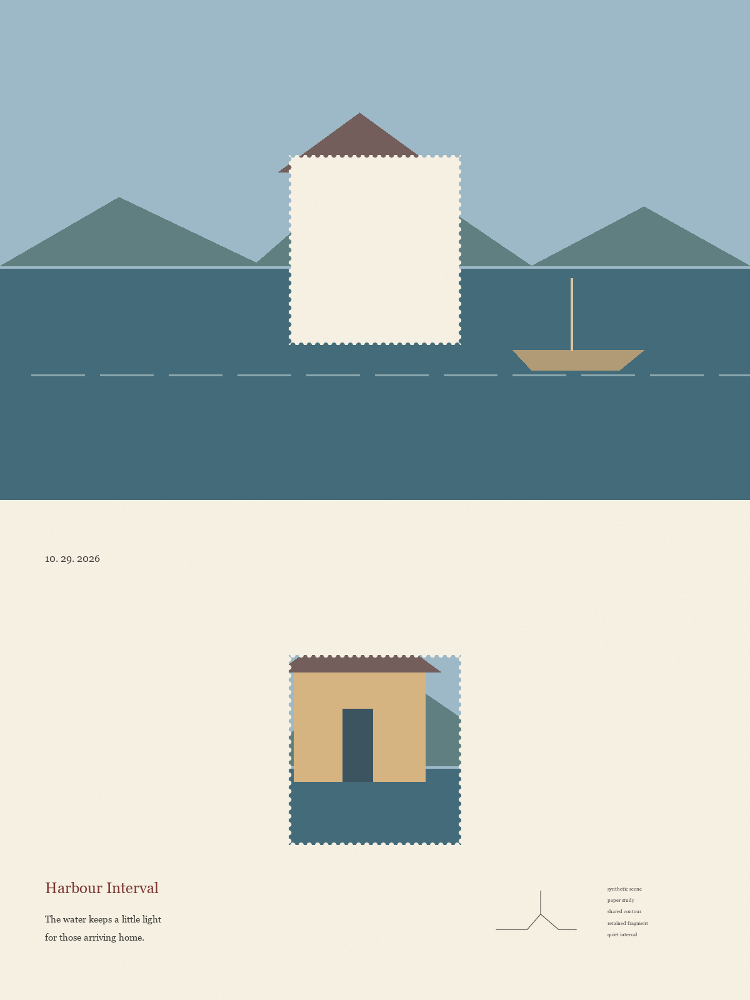

# Photo Cutout Zine · 邮票挖空纸刊

把一张照片变成一页 3:4 独立刊物：上半部的中央挖出一枚邮票，下半部保存从原位置取出的同一块影像。

An agent skill for turning a photograph into an editorial cut-out zine. One shared stamp shape connects the empty paper hole above with the extracted photo fragment below.



*上图是程序绘制的合成场景与确定性拼合演示，不是实拍照片或生成模型效果承诺。示例配置见 [examples/demo-config.json](examples/demo-config.json)。*

## 使用

安装到支持 Agent Skills 的工具：

```bash
npx skills add fledgling-david/photo-cutout-zine
```

也可以下载仓库，将含 `SKILL.md` 的完整文件夹放入宿主的技能目录。上传照片后说：

```text
使用 $photo-cutout-zine 处理这张照片，自动决定裁切和文案，直接交付成品。
```

一次提供多张照片时，每张分别制作一张。需要专用智能体只收图就开始，可在该智能体的默认指令中指定使用本技能。

## 核心关系

- 竖向 3:4，上下严格等高。
- 上半部保留摄影的真实内容、色彩与场景关系，仅裁切和等比缩放。
- 上部几何中心挖出竖向齿孔邮票形，孔内是下半部同款象牙纸。
- 下方邮票使用上方挖出前的同一位置、同一尺寸、同一内容。
- 自动配短英文标题、两行诗、日期、次要元素线稿与极小注记。
- 日期优先使用用户指定值，其次可靠拍摄时间，否则使用用户当地当天日期。

## 两条执行路线

| 宿主能力 | 路线 |
| --- | --- |
| 能看图并编辑参考图 | 根据完整规范生成并检查。生成式编辑可能改变像素，不能仅凭提示词承诺无损。 |
| 允许 Python 与 Pillow 处理本地文件 | 用共享掩模裁切和复制，保存后重新读取 PNG 校验。 |
| 只能看图或聊天 | 提供根据当前照片编译的提示词，说明尚未生成图片。 |

技能本身不附带图像模型、API Key 或生成额度，不绑定某一家服务。遵循宿主实际提供的工具和权限。

## 精确拼合脚本

需要 Python 3.10+ 与 Pillow 10+。使用自己的环境安装依赖：

```bash
python -m pip install -r requirements.txt
python scripts/compose_zine.py --image photo.jpg --config examples/demo-config.json --output result.png --width 1200
```

示例 JSON 只演示字段格式，文案、裁切与线稿应依据输入照片调整。支持 `--font` 指定本机已有衬线字体；不随仓库分发系统字体。

脚本保护源文件，拒绝覆盖已有输出。精确保证的范围是排版裁切与缩放之后，上孔和下邮票使用同一照片区域与共享齿孔掩模，不等于成品与原始照片文件逐像素相同。

完整说明：[SKILL.md](SKILL.md) · [精确拼合](references/exact-composition.md) · [通用提示词](references/generation-prompt.md)

## 验证

```bash
python -m unittest discover -s tests -v
```

测试覆盖 3:4 比例、上下等高、中心对齐、邮票像素复制、空纸孔洞、照片外露区、拒绝覆盖与无效日期。未声称已在所有智能体或图像模型上完成实测。

## 来源与许可

维护者：[@fledgling-david](https://github.com/fledgling-david)。原始视觉玩法的来源是用户提供、文件名标注为小红书 **@梅闻话** 的三页提示词资料。此仓库将其整理为可执行技能，并增加了宿主能力分流、日期规则、确定性拼合、校验与失败边界。详见 [CREDITS.md](CREDITS.md)。

本仓库的原创实现和新编写的说明以 [MIT License](LICENSE) 发布。原始 PDF、第三方图片、字体及其权利未包含在 MIT 授权中，也没有随仓库上传。使用者处理的照片及生成图片仍受其各自来源和宿主条款约束。
